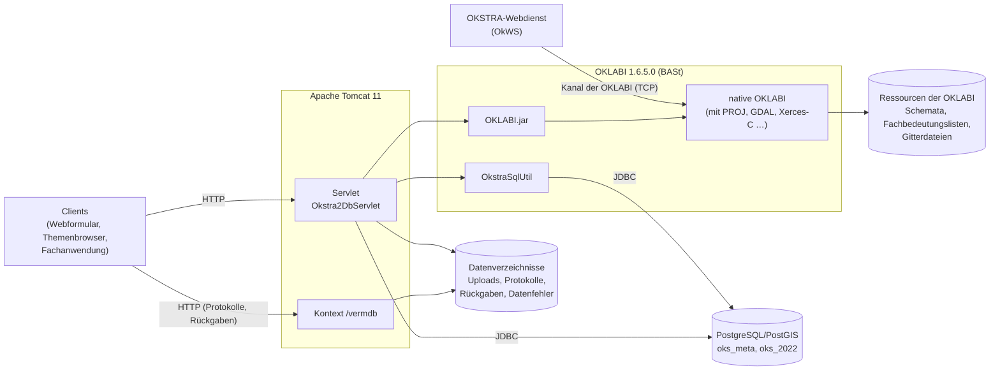
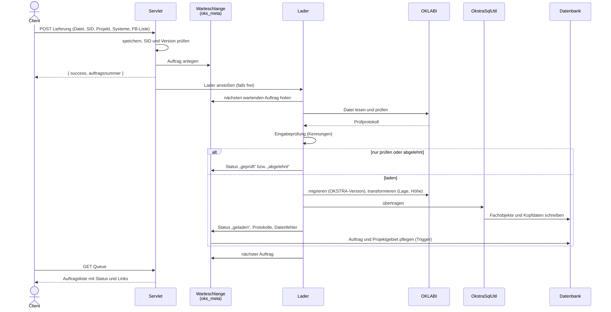
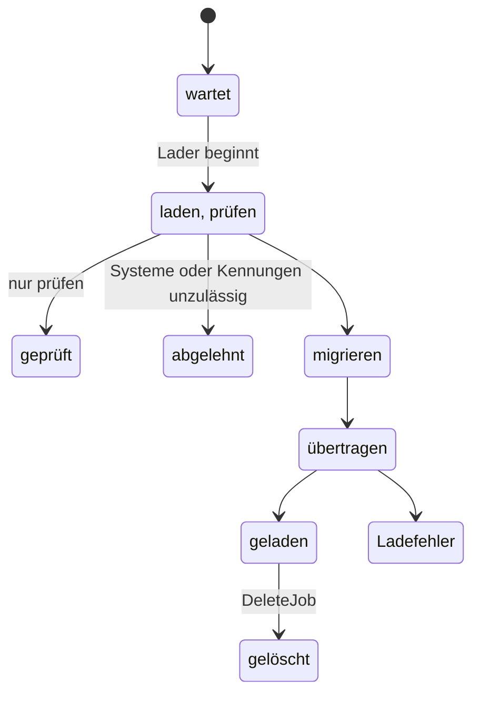
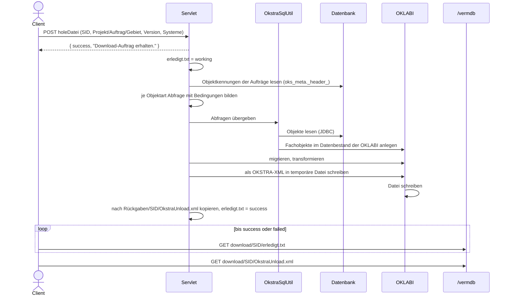
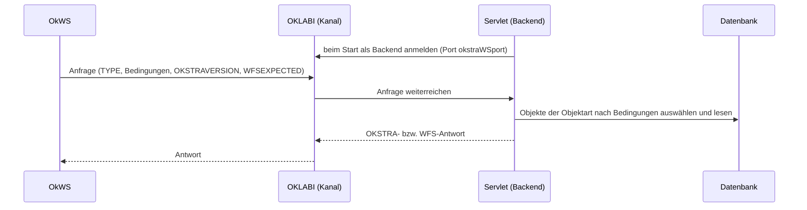

<!--
SPDX-FileCopyrightText: 2026 interactive instruments GmbH
SPDX-License-Identifier: AGPL-3.0-or-later
-->

# Überblick und Architektur

## 1. Zweck

Die Vermessungsdatenbank verwaltet Vermessungsdaten des Straßenbaus im Format des OKSTRA
(Objektkatalog für das Straßen- und Verkehrswesen): Bestands- und Baubestandsvermessungen
mit Punkten, Linien, Flächen, Symbolen und Beschriftungen, deren Bedeutung die
Fachbedeutungslisten der Länder festlegen, dazu Fachobjekte wie Böschungen oder Bauwerke.

Sie nimmt Lieferungen von Vermessungsstellen entgegen, prüft sie, rechnet sie in die
OKSTRA-Version, das Lage- und das Höhensystem der Datenbank um und lädt sie in eine
PostgreSQL-Datenbank mit PostGIS. Jede Lieferung bildet einen Auftrag; Aufträge gehören zu
Projekten. Aus der Datenbank gibt sie Daten wieder als OKSTRA-Datei ab, ausgewählt nach
Projekt, Auftrag oder Gebiet und umgerechnet in die gewünschte Version und das gewünschte
Lagesystem. Andere Anwendungen, etwa ein Kartendienst, lesen die Datenbank direkt oder
fragen sie über den OKSTRA-Webdienst (OkWS) ab.

Die Anwendung ist ein Servlet für Apache Tomcat. Die fachliche Arbeit am OKSTRA (Lesen,
Prüfen, Migrieren, Transformieren, Schreiben) leistet die OKSTRA-Klassenbibliothek (OKLABI)
der Bundesanstalt für Straßen- und Verkehrswesen, die Übertragung zwischen OKLABI und
Datenbank deren Komponente `OkstraSqlUtil`. Entstanden ist die Vermessungsdatenbank ab 2014
für eine Landesstraßenbauverwaltung.

## 2. Komponenten

| Komponente | Aufgabe |
|---|---|
| **Servlet** `Okstra2DbServlet` | nimmt Anfragen über HTTP an, führt die Warteschlange, steuert Prüfen, Laden und Entladen, schreibt Protokolle und Auftragslisten |
| **OKLABI** (`OKLABI.jar` und native Bibliothek) | liest und schreibt OKSTRA-Dateien (XML; CTE weist der Dienst ab), prüft gegen Schema, Schlüsseltabellen und Fachbedeutungslisten, migriert zwischen OKSTRA-Versionen, transformiert Koordinaten (PROJ mit Gitterdateien); stellt den Kanal für den OkWS bereit |
| **`OkstraSqlUtil`** | überträgt Datenbestände der OKLABI in die Datenbank und liest sie zurück; legt die Tabellen des OKSTRA-Schemas beim ersten Laden selbst an |
| **PostgreSQL mit PostGIS** | Schema `oks_meta` für Warteschlange, Aufträge, Projekte, Kopfdaten, Fachbedeutungslisten und weitere Listen; OKSTRA-Schema (etwa `oks_2022`) mit einer Tabelle je Objektart |
| **Datenverzeichnisse** | hochgeladene Lieferungen, Protokolle, Rückgaben je Anfrage, Datenfehler |
| **Kontext `/vermdb`** bzw. Webserver | liefert Protokolle, Datenfehler und Rückgaben an die Clients aus |
| **OkWS** | eigener Webdienst, der die Vermessungsdatenbank über den Kanal der OKLABI abfragt (optional) |

Auf die Datenbank greifen nur das Servlet und `OkstraSqlUtil` zu, beide in Java über JDBC
mit den Datenquellen des Tomcat. Die native OKLABI hat in dieser Version keine eigene
Verbindung zu PostgreSQL; sie liest nur ihre Ressourcen, darunter die Schemadatenbank
(SQLite).

Die Datenbank hat zwei Datenquellen, die auf dieselbe Datenbank zeigen: die OKSTRA-Daten
und die Service-Datenbank mit `oks_meta`. Optional kommen getrennte Datenbanken für
Altdaten und Planungsdaten hinzu, mit derselben Struktur.

### Datenhaltung

| Schema | Inhalt |
|---|---|
| `oks_meta` | `warteschlange` (Aufträge mit Status und Protokollen), `auftrag` und `projekt` (mit Gebietsgeometrie), `_header_` mit `txtpool` (Kopfdaten jedes Fachobjekts: Auftrag, Fachbedeutungsliste, Lage- und Höhensystem der Lieferung), `fbliste` mit `efbversion` (Fachbedeutungslisten), `ekoordrefsys` (Lage- und Höhensysteme), `gebiete`, `fbausschluss`; Funktionen zum Pflegen von Auftrag und Projekt und zum Löschen eines Auftrags |
| OKSTRA-Schema, etwa `oks_2022` | eine Tabelle je Objektart der OKSTRA-Version der Datenbank, Zwischentabelle für Beziehungen, Metadaten von `OkstraSqlUtil`; angelegt beim ersten Laden |

Die Skripte für `oks_meta` liegen in `Datenbank/` (`Datenbank/README.md`).

## 3. Abläufe

### 3.1 Lieferung laden

Lieferungen gehen in eine Warteschlange; ein einzelner Lader arbeitet sie nacheinander ab.

Der Status eines Auftrags (`doku/Schnittstelle.md`, 5):

### 3.2 Daten entladen

Das Servlet wählt die Objekte aus (Bedingungen je Objektart), `OkstraSqlUtil` liest sie per
JDBC und legt sie als Fachobjekte in einem Datenbestand der OKLABI an. Die OKLABI migriert und
transformiert den Bestand und schreibt ihn selbst als OKSTRA-XML in eine temporäre Datei.
Synchron (GET `Read`) reicht das Servlet diese Datei Byte für Byte in die Antwort durch;
asynchron (POST `holeDatei`) antwortet es sofort und kopiert die Datei in das
Rückgabeverzeichnis der Anfrage, wo der Client sie über `okstraServerPrefix` abholt. Die
temporäre Datei löscht es danach.

### 3.3 OkWS

Der OkWS fragt einzelne Objektarten mit Bedingungen ab. Er spricht nicht HTTP mit dem
Servlet, sondern den Kommunikationskanal der OKLABI; das Servlet meldet sich dort beim Start
als Backend an (`okstraWSbackend`).

## 4. Repository

| Ordner | Inhalt |
|---|---|
| `DatenbankLader/` | die Webanwendung: Servlet (`src/main/java`), `web.xml`-Vorlage und `context.xml` (`src/main/webapp`), Unit-Tests (`src/test/java`) |
| `Datenbank/` | Skripte für die Datenbank (`oks_meta`), Laden der Fachbedeutungslisten |
| `Container/` | Image und Compose für die Standardinstallation |
| `werkzeuge/` | Hilfsprogramme für die Installation (`proj.db`, Höhengitter) |
| `oklabi-release/` | Java-Archive des OKLABI-Release, vom Bau geladen (nicht versioniert) |
| `doku/` | Dokumentation |
| `LICENSES/`, `NOTICE`, `REUSE.toml` | Lizenzen |

Gebaut wird mit Gradle (`README.md`). Das WAR enthält das Servlet, `OkstraSqlUtil` und die
Bibliotheken aus Maven Central (Apache Commons IO, Log4j, PostgreSQL-JDBC); `OKLABI.jar`
und der PostgreSQL-Treiber gehören in das `lib`-Verzeichnis des Tomcat, die native OKLABI
neben ihn.

## 5. Weiter

* `doku/Installation.md`: Installation im Container und mit eigenem Tomcat
* `doku/Konfiguration.md`: Parameter und Umgebung
* `doku/Schnittstelle.md`: Anfragen, Status, bekannte Einschränkungen
* `doku/Betrieb.md`: Betrieb, Fehlerbilder, Sicherung
